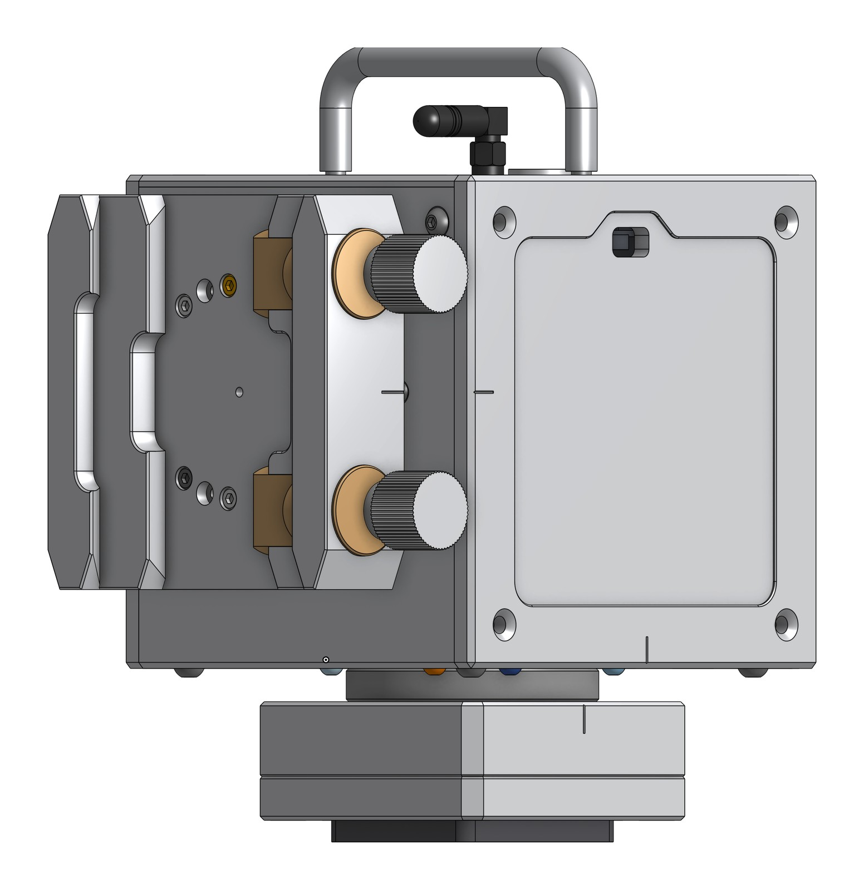
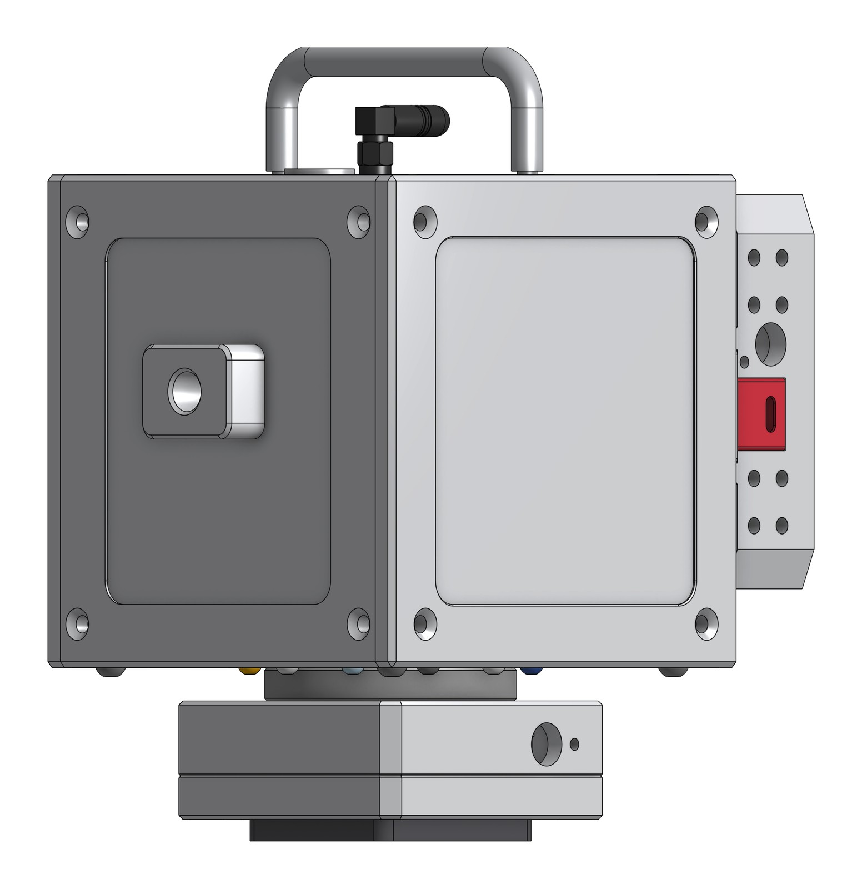

# HEMY 2R

**A restyled HEMY v2 harmonic equatorial mount in a 125 mm aluminium cube.**

HEMY 2R keeps polvinc's [HEMY v2](https://github.com/polvinc/HEMY) mechanism and electronics (two HBK17 100:1 harmonic reducers, NEMA17 motors on belts, OnStepX on a Teensy MicroMod) and puts them in a new shell: a one-piece L-plate frame, 6 mm panels, a counterweight wall, a carry handle and a square base for the Angeleyes LA-40B wedge.

| Side A (east at home) | Side B (west): the side you plug into |
|---|---|
|  |  |

<sub>Onshape views of the v2.2 CAD at the home position (knobs east). Counterweight bar hidden; the LA-40B is a placeholder block. More views and the inside in the [design overview](hemy2r/docs/01-design-overview.md#views).</sub>

> **Status: design stage, not yet built.** The CAD is complete for a first build and has been quoted for CNC. One reducer has been measured against the CAD. Nothing here has been tested on the sky yet. Use it at your own risk and read the [design review](hemy2r/docs/design-review.md) first.

## At a glance

| | |
|---|---|
| Mount type | German equatorial, harmonic drive (strain wave) on both axes |
| Reducers | 2 × HBK17, 100:1, Ø19 through-bore |
| Drive | NEMA17 17HM15-0904S → 20T/70T belt → reducer |
| Controller | OnStepX on Teensy 4.0 MicroMod (polvinc's TeenAstro Redux v2.6.5M board) |
| Links | USB-C on side A, USB-C (UART) on the dovetail, Wi-Fi (ESP32-C3), GPS |
| Power | One 12 V 10 A input at the base; fused 12 V accessory jack on the dovetail |
| Body | 125 mm cube, 6061 aluminium, bead-blasted, clear anodized |
| Saddle | polvinc's dual Vixen + Losmandy dovetail |
| Counterweight | Ø20 bar, M12 × 1.75, on the far wall (Skywatcher SA GTi bar fits) |
| Base | 80 × 80 flange + plate onto an Angeleyes LA-40B |
| Weight | ≈ 4.6 kg without the base, ≈ 5.8 kg with LA-40B, flange and plate |
| License | GPL-3.0 (same as HEMY) |

## What's different from HEMY v2

Unchanged: reducers, motors, pulleys, belts, motor and brake supports, the dovetail saddle and clamp, and polvinc's boards (for the first build).

| Area | HEMY 2R change |
|---|---|
| Frame | One-piece L-plate (floor + back wall), M4 corner cubes, plain 6 mm panels with laser-marked recesses |
| RA axis | Reducer seat moved 6 mm toward the back wall: shorter payload arm, RA axis almost centred under the cube |
| Counterweight | SAL-33-style lug on the far wall for an M12 bar (HEMY v2 runs without one) |
| Base | 80 × 80 flange + plate onto the LA-40B, replacing the A11 flange and Vixen saddle; the power input lives in the flange |
| Power | One 10 A input, fused and split inside to the mount and to a 12 V accessory jack on the dovetail |
| Dovetail | Side bay closed: 10 A jack, LED, and a USB-C serial module in a small red-anodized insert |
| Board | Turned 90° and hung under the lid; its USB-C is reached through a window in side A |
| Lid | Carry handle, power switch, Wi-Fi antenna, GPS patch under a sticker |
| Electronics (experiment) | Main board and brake board merged into one board with extra protection ([pcb/single-board](hemy2r/pcb/single-board/)) |

## Documentation

| | |
|---|---|
| [Design overview](hemy2r/docs/01-design-overview.md) | Concept, key decisions, loads and weights |
| [Mechanical parts](hemy2r/docs/02-mechanical-parts.md) | Every machined part, finishes, screws and torques |
| [Power and wiring](hemy2r/docs/03-power-and-wiring.md) | Power path, fuses, connectors, the dovetail bay, control links |
| [Electronics and firmware](hemy2r/docs/04-electronics.md) | Boards, the single-board experiment, OnStepX settings |
| [Assembly and setup](hemy2r/docs/05-assembly.md) | Build order, balancing, home position, commissioning |
| [Manufacturing](hemy2r/docs/06-manufacturing.md) | What to upload to JLCCNC / JLCPCB and the drawing notes |
| [Design review](hemy2r/docs/design-review.md) | Known risks (mechanical M1–M10, electrical E1–E11) and their status |
| [How to review this project](hemy2r/docs/reviewing.md) | For reviewers: what to look at and how to give feedback |
| [Changelog](CHANGELOG.md) | |

## Repository layout

```
README.md               this page
CHANGELOG.md
hemy2r/
  docs/                 HEMY 2R documentation and images
  cad/
    parts/              STEP files to machine (and polvinc's unchanged parts)
    assemblies/         full STEP assembly
    reference/          LA-40B interface, measured placeholders
    logo/               laser-marking and sticker artwork
    tools/              CadQuery/OCP scripts that generated the parts
  concepts/             studies that are not part of the build (v2.3 window lid)
  pcb/
    jlc-order/          upload-ready files for polvinc's boards (build #1)
    single-board/       merged main + brake board experiment (EasyEDA Pro)
docs/ hardware/ images/ software/
                        polvinc's original HEMY v2 files, unchanged
```

The original HEMY v2 README is kept at [docs/HEMY-v2-README.md](docs/HEMY-v2-README.md).

## Opening the files

- **STEP:** any CAD viewer (FreeCAD, Fusion, Onshape, eDrawings). The full assembly is 55 MB.
- **EasyEDA Pro (.epro):** File → Open → Import EasyEDA Pro project, in EasyEDA Pro 2.2 or later (free).
- **Scripts:** Python 3 with `cadquery-ocp`. Each script lists its inputs at the top.
- Large files that don't fit in git (the v2.3 concept assembly) are attached to the [Releases](../../releases).

## Credits

- **HEMY v2** by **polvinc** and contributors: <https://github.com/polvinc/HEMY>. The mechanism, the electronics, OnStepX integration and most of the engineering are theirs.
- **HEMY 2R** restyle by **Avinash C. Indirabai**, with design work, CAD scripting and checks done together with Claude (Anthropic).
- This is an unofficial variant, not supported by the HEMY project. Questions about HEMY itself belong in polvinc's repository.

Licensed under the [GNU GPL v3.0](LICENSE), like the original.
