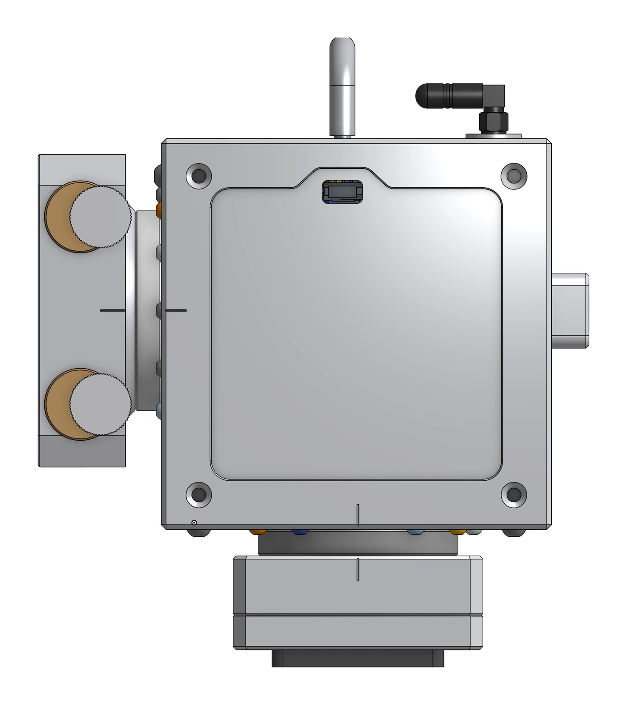
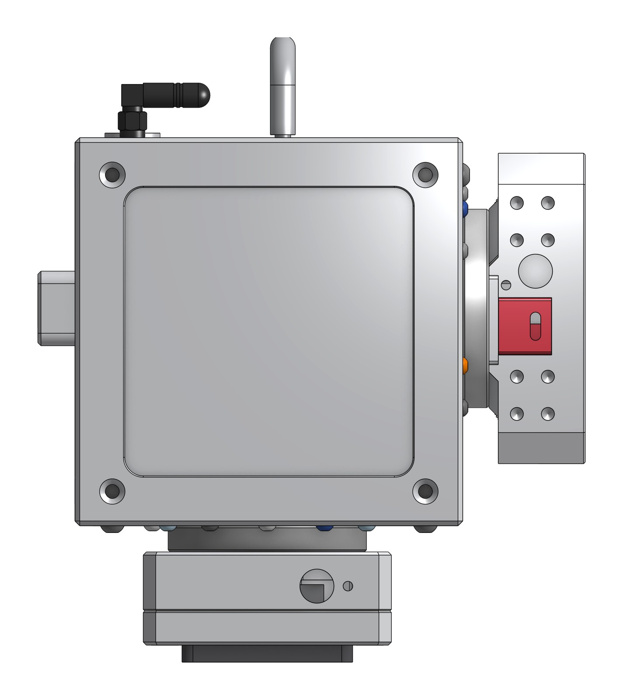
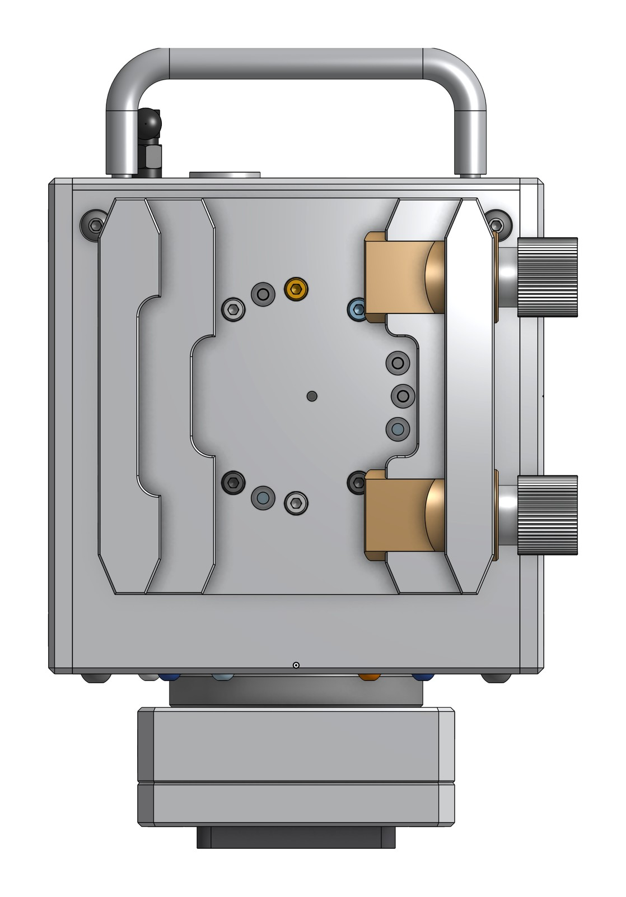
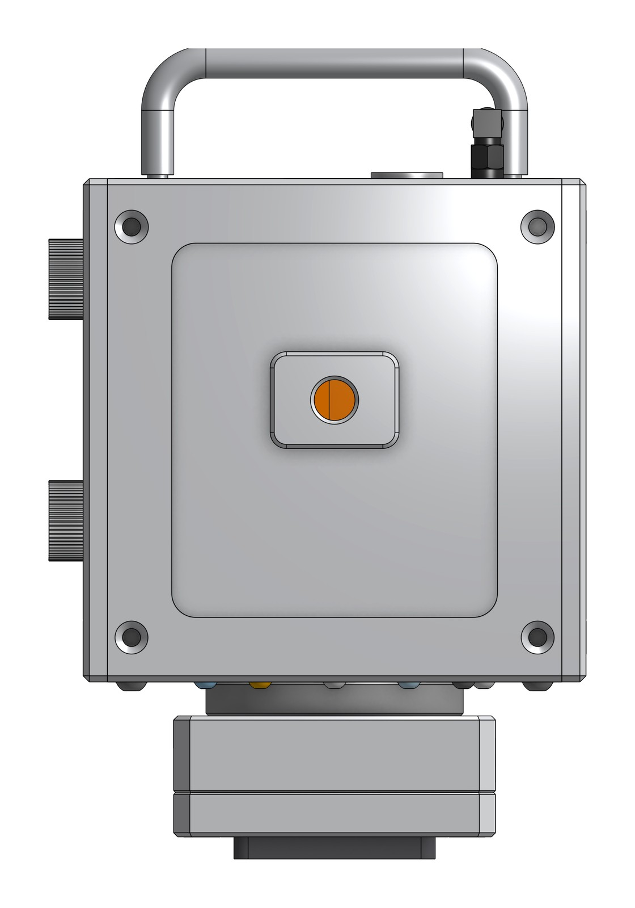
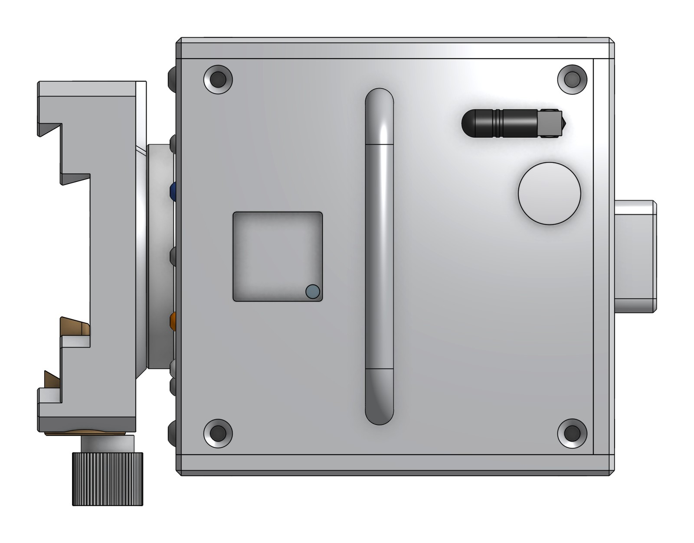
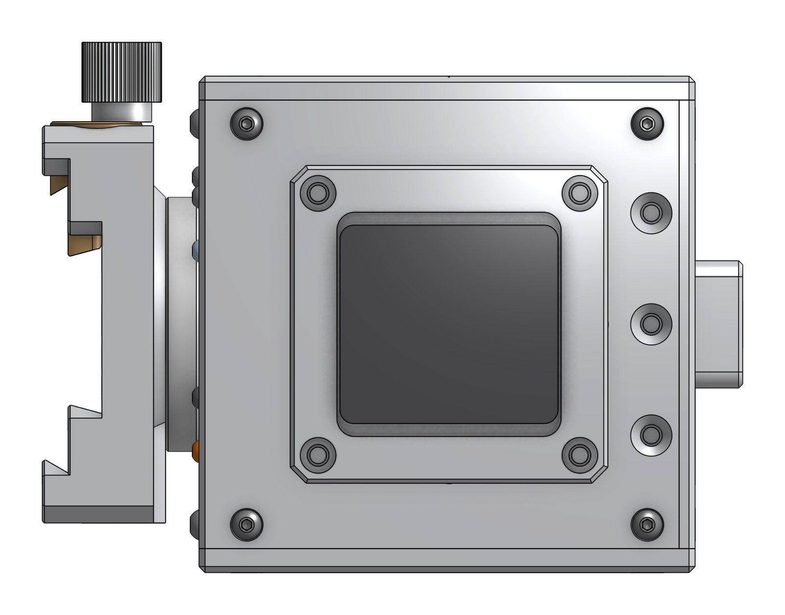
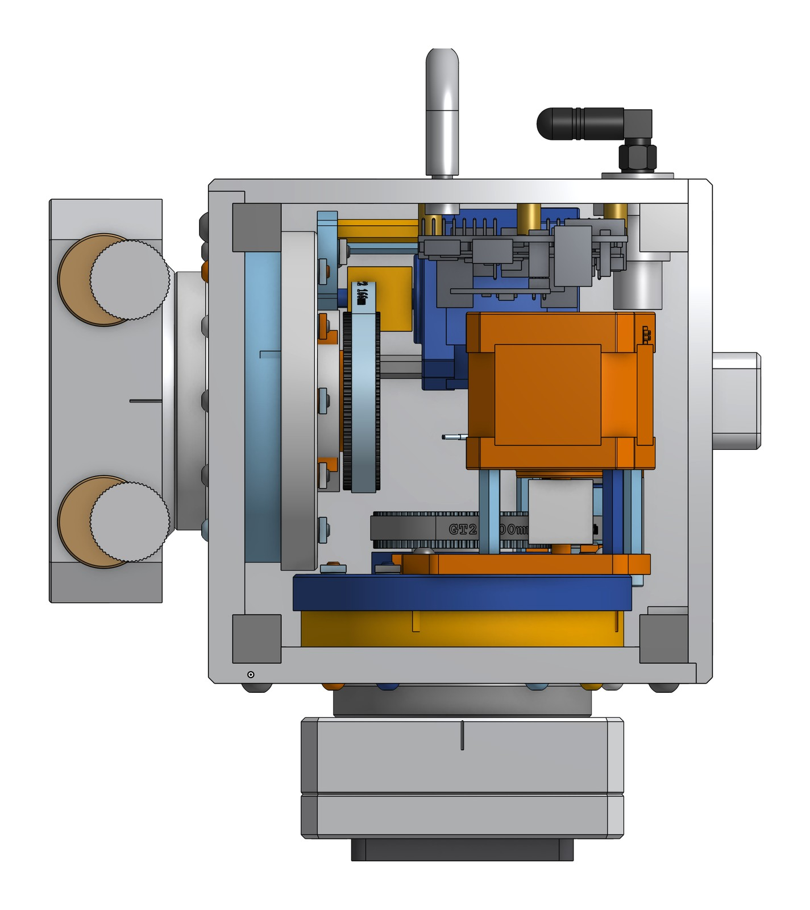
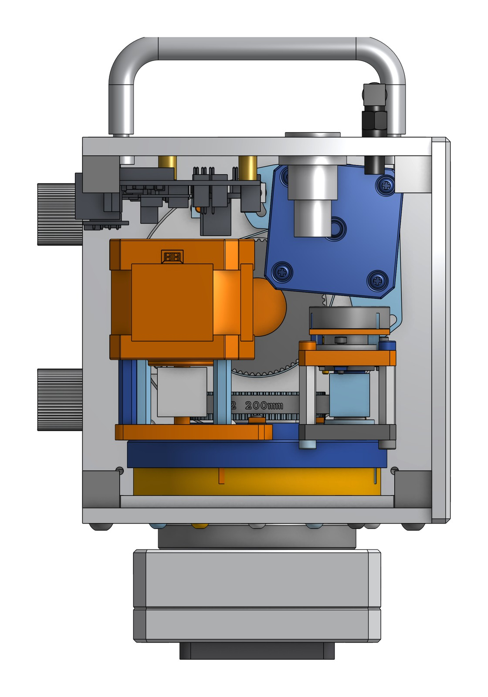

# 1. Design overview

[← Back to README](../../README.md) · Next: [Mechanical parts →](02-mechanical-parts.md)

## The idea

HEMY v2 is a proven harmonic-drive mount. HEMY 2R changes only what you see and touch: the shell, the frame, the base, the dovetail bay and the cable layout. The goal is a compact cube in the style of commercial strain-wave mounts (ZWO AM5, SAL-33), with every cable you plug in each night on one side and nothing outside the box that can snag.

## Views

All at the home position (knobs east). The counterweight bar is hidden.

| Side A (front, east) | Side B (back, west) |
|---|---|
|  |  |
| **Dovetail end** | **Counterweight wall** |
|  |  |
| **Top (lid)** | **Bottom** |
|  |  |

### Inside

| Side A removed | Counterweight wall removed |
|---|---|
|  |  |

The board hangs under the lid; the RA reducer sits half in the floor and the DEC reducer half in the back wall, each driven by a NEMA17 over a belt.

## Coordinate system and naming

All positions in these docs are in the CAD frame of `hemy2r/cad/assemblies/HEMY2R v2.2 - assembly.step`, in millimetres:

| | |
|---|---|
| Z | Up, parallel to the RA axis; the base flange sits below the cube at Z −27.5…−8.5 |
| RA axis | Vertical, at X −6, Y 0 |
| DEC axis | Parallel to X, through Y 0, Z 70 |
| Side A | The −Y side plate: USB-C window, owner badge, home marks |
| Side B | The +Y side plate: HEMY 2R logo |
| Far wall | The counterweight wall, opposite the back wall |

**Home position:** counterweight down, scope parallel to the RA axis, dovetail knobs facing **east**. Standing south of the mount (northern hemisphere), side A faces you on the east, and every connector you use each night (base power, dovetail USB-C and accessory jack) is on side B, the west.

## Key decisions

| Decision | Why |
|---|---|
| **125 mm cube, one-piece L-plate** | One part holds both reducers, so RA/DEC squareness depends on a single part's tolerances, and the panels become plain plates. |
| **RA reducer moved 6 mm toward the back wall** | Shorter payload arm, more room behind the RA motor, RA axis almost centred under the cube. |
| **12 mm M4 corner cubes in all 8 corners** | Every panel and lid screw is the same M4 flat head. The cubes are cheap and replaceable. |
| **Board turned 90°, hung from the lid** | Its edge connectors face side A; lifting the lid lifts the board out for bench work. |
| **Counterweight wall** | The FRA300-class payloads this was designed around (≈ 5 kg, balance point ≈ 70 mm above the dovetail) put ≈ 7.5–9 N·m on RA without one. A counterweight takes that load off the drive and the output bearing. |
| **Square 80 × 80 base flange** | Cleared the LA-40B through 0–50° latitude with a card test; the corner M5 screws stay reachable. |
| **Single 12 V input at the base** | One cable from the battery. The accessory output on the dovetail is fused separately, so a short at the telescope never drops the mount. |
| **Dovetail electronics in a replaceable insert** | Everything that depends on the bought USB-serial module lives in a small part that's cheap to remake. The dovetail itself can be machined before the module is measured. |
| **No driver heatsinks** | The motors run at 0.4–0.9 A (see [firmware settings](04-electronics.md#firmware-settings)). |
| **Keyed connectors everywhere** | Nothing inside the box can be plugged in reversed or rotated. |

## Loads

| | Value | Notes |
|---|---|---|
| HBK17 100:1 rated torque | 31 N·m | 51 max average, 70 start/stop peak, 143 momentary |
| Backlash | ≤ 10″ listed | Seller says 40–50″ in practice; plan for that (see [balancing](05-assembly.md#balancing)) |
| RA load, ≈ 5 kg scope, no counterweight | ≈ 7.5–9 N·m | ≈ 25–30 % of rated |
| RA load, balanced | ≈ 0.5 N·m | Deliberately east-heavy |
| Dovetail face to RA axis | ≈ 0.10 m | |

Output bearing moment ratings for the HBK17 aren't published by the seller. A comparable size-17 unit (Honpine FHG-17) lists 72 N·m bending moment and 400 N radial/axial; HEMY 2R's estimated loads are 15–40 % of that class.

## Weights

| | |
|---|---|
| Mount without base | ≈ 4.6 kg |
| With LA-40B, flange and plate | ≈ 5.8 kg |
| Base flange / base plate | ≈ 256 g / ≈ 154 g |

## What stays polvinc's

Reducers, motors, pulleys (16T/70T), belts, motor supports, brake supports and shaft, the SWB-003 brake and its coupling, the dovetail saddle and clamp geometry, the main board and the brake board. If you are building HEMY 2R, polvinc's [HEMY v2 docs](../../docs/) remain the reference for those parts.
