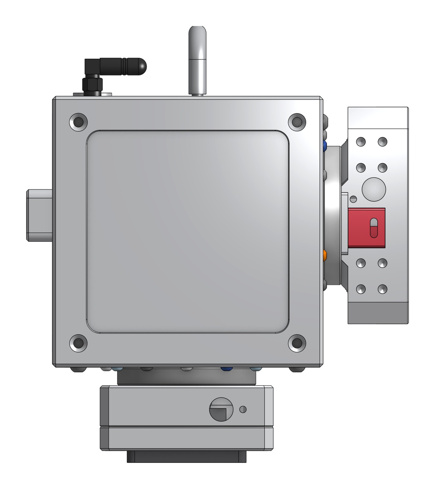

# 2. Mechanical parts

[← Design overview](01-design-overview.md) · Next: [Power and wiring →](03-power-and-wiring.md)

All files are in [`hemy2r/cad/parts/`](../cad/parts/). Material is 6061 aluminium unless noted. **Finish:** bead blast, then clear (natural/silver) Type II anodize, matte. **Break all sharp edges 0.3 mm.**

## Parts to machine

### Body

| Part | File | Qty | Notes |
|---|---|---|---|
| L-plate | `HEMY2R - L-plate v2.2.step` | 1 | Floor + back wall in one piece. Both reducer seats, with 10 clamp holes each (90° countersinks, Ø6.3) on the outside. 3 × M5 countersunk under the floor for the far wall's foot. |
| Side plate A | `HEMY2R - Side plate A (recessed panel).step` | 1 | 93 × 93 × 0.8 mm recess with a laser-marked badge. USB-C window 13 × 7.5 mm (R2) to the board's own USB-C. RA and DEC home marks. |
| Side plate B | `HEMY2R - Side plate B (recessed panel).step` | 1 | Same recess, laser-marked HEMY 2R logo. No marks. |
| Far wall (counterweight) | `HEMY2R - Far wall CW (recessed panel).step` | 1 | 32 × 24 mm lug, 12 mm proud, on the DEC axis; **M12 × 1.75** through lug and wall. Internal foot held by 3 × M5 up through the floor. |
| Lid | `HEMY2R - Lid.step` | 1 | Board spacer threads (M3), Ø16.2 switch hole, Wi-Fi SMA hole, 2 × M5 handle holes countersunk from below, 25.5 × 25.5 × 5 mm GPS antenna pocket with a Ø4 lead hole. |

### Dovetail

| Part | File | Qty | Notes |
|---|---|---|---|
| Dovetail | `HEMY2R - Dovetail (CH340E insert + 10 A bay).step` | 1 | polvinc's saddle and clamp. Side bay closed: tapped M12 hole for the 10 A jack, Ø3.1 LED hole, T-slot for the insert. Thread callouts: `09_Dovetail_threads_drawing.pdf` (polvinc's; the bay threads still need adding). |
| Dovetail insert | `HEMY2R - Dovetail CH340E insert (red anodize).step` | 1 | **Red anodize** (the only red part). Holds the USB-serial module; USB-C window 9.1 × 3.4 mm in a 0.8 mm skin; 2 × M2 tapped. |
| Dovetail bay cover | `HEMY2R - Dovetail bay cover.step` | 1 | 3 mm, natural anodize, 2 × M2.5 countersunk. Holds the insert in. |
| Dovetail jaws | polvinc's geometry (in the assembly) | 2 | Bronze or brass. See galvanic note [M9](design-review.md#m9). |

### Base

| Part | File | Qty | Notes |
|---|---|---|---|
| Base flange | `HEMY2R - Base flange v2.2 80x80.step` | 1 | 80 × 80 × 19 mm. Bolts to the RA reducer output with 12 × M3 (A11 pattern). Tapped M12 for the 10 A input jack + Ø3.1 LED on the side B face, sharing one bay machined from the bottom; wire slot to the centre bore. 4 × M5 × 12 deep at the corners. |
| Base plate | `HEMY2R - Base plate v2.2 80x80.step` | 1 | 80 × 80 × 11 mm. 56.5 × 56.5 R4.5 × 3 mm recess for the LA-40B top plate; 4 × M6 countersunk down into the LA-40B; 4 × Ø5.5 with Ø9 counterbores from below for the flange screws. |

### Unchanged polvinc parts

| Part | File | Qty |
|---|---|---|
| 07 Pulley 70T | `07_Pulley70T_qty2.step` | 2 |
| 08 Brake support | `08_BrakeSupport_qty2.step` | 2 |
| 10 Motor support | `stock_hemy_parts/10_MotorSupport_qty2.step` | 2 |
| 11 Dovetail fix clamp | `stock_hemy_parts/11_DovetailFixClamp_qty2.step` | 2 |
| 13 SWB-003 shaft coupling | `stock_hemy_parts/13_SWB003_ShaftCoupling_qty1.step` | 1 |

The coupling is needed: the brake shaft has a 4.5 mm flat and the brake's own coupling takes 4.0 mm.

## Bought parts

| Part | Qty | Notes |
|---|---|---|
| HBK17 100:1 harmonic reducer | 2 | Measured unit matches the seller's CAD: Ø80 body, Ø84 plate, Ø19 bore, 56.5 mm tall |
| NEMA17 17HM15-0904S | 2 | |
| 20T motor pulleys, belts, 16T brake pulley, 200 mm RA belt, 625ZZ bearings, 5 × 40 shaft | | As HEMY v2 |
| SWB-003 24 V brake | 1 | Optional at first; supports and shaft are fitted from day one |
| Corner cubes, 12 mm, M4 | 8 | Aluminium (as ordered); steel preferred for the lid corners |
| Knurled clamp knobs D20 × 20, M6 × 40 stainless, POM tip | 2 | **Not M6 × 45**: it bottoms out |
| Carry handle, M5 | 1 | |
| 16 mm latching switch (TechEss) | 1 | M16 × 1, fits the 6 mm lid with ≈ 1 mm to spare |
| 10 A 5.5 × 2.1 panel jack, M12 thread | 2 | Base input and dovetail accessory. Confirm the M12 pitch. |
| CH340E USB-C serial module (BTE17-06 type) | 1 | 16 × 16 mm |
| Counterweight bar Ø20, M12 × 1.75 + weight | 1 | A Skywatcher SA GTi bar fits; washer or stop at the end |
| 25 × 25 ceramic GPS patch, U.FL lead | 1 | |
| Silica gel pack | 1 | |

## Screws

Flat heads match the 90° countersinks: **ISO 14581 Torx, stainless A2-70.** Use Tef-Gel or another **non-copper** anti-seize on every stainless thread into aluminium; no threadlocker on panels.

| Where | Screw | Qty |
|---|---|---|
| Reducer clamps, RA + DEC (hex nuts inside) | M3 × 30 flat head | 20 |
| Panels, lid, floor, back wall (into the corner cubes) | M4 × 10 flat head | 22 |
| Far wall foot (up through the floor) | M5 × 16 flat head | 3 |
| Handle (from inside the lid) | M5 × 12 flat head, ISO 10642 | 2 |
| Base plate → LA-40B | M6 × 16 countersunk, ISO 10642 | 4 |
| Flange → base plate (from below) | M5 × 16 socket head, ISO 4762 | 4 |
| Base flange → RA reducer output | M3, as polvinc's A11 flange | 12 |
| Dovetail bay cover | M2.5 countersunk, ISO 14581 | 2 |
| USB module → insert | M2 | 2 |
| Counterweight hole cap (bar off) | M12, thread ≤ 12 mm | 1 |
| Internal cable tie-downs | M3 × 5–6 button head | as needed |

### Torque (lubricated)

These assume anti-seize. Dry catalogue values (1.2 N·m for M3, 2.85 N·m for M4) overload A2-70 screws once the threads are lubricated ([M1](design-review.md#m1)).

| Screw | Into | Torque |
|---|---|---|
| M3 | Reducer clamps, reducer output, tie-downs | 0.8 N·m |
| M4 | Corner cubes | 1.5 N·m (aluminium cubes), 1.8 N·m (steel) |
| M5 | Handle, far wall foot, flange → plate | 3.5 N·m |
| M6 | Base plate → LA-40B | 6 N·m |
| Anything else | | ≈ 65–70 % of the dry value |

Use a small torque screwdriver (0.5–5 N·m). Panels only need to seat.
