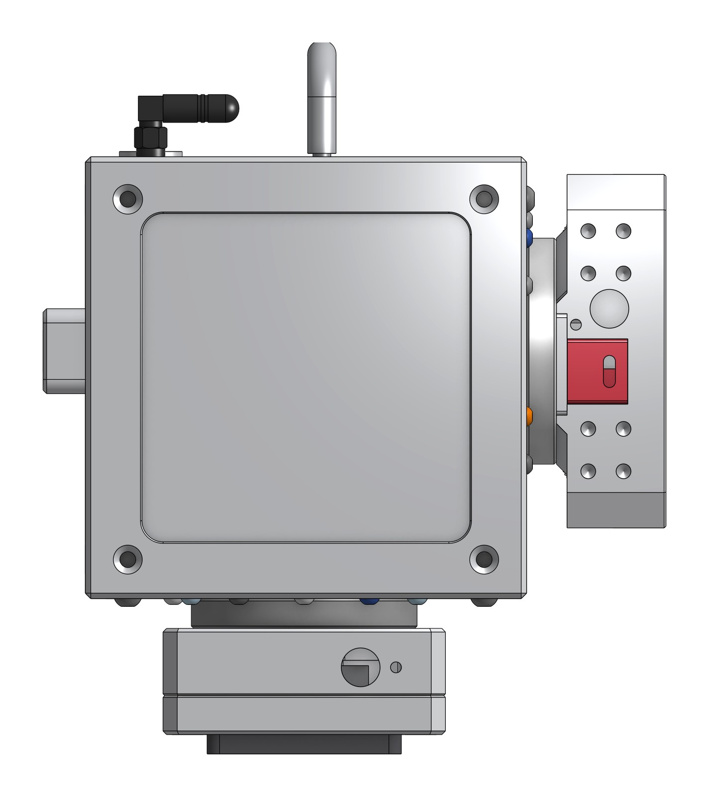
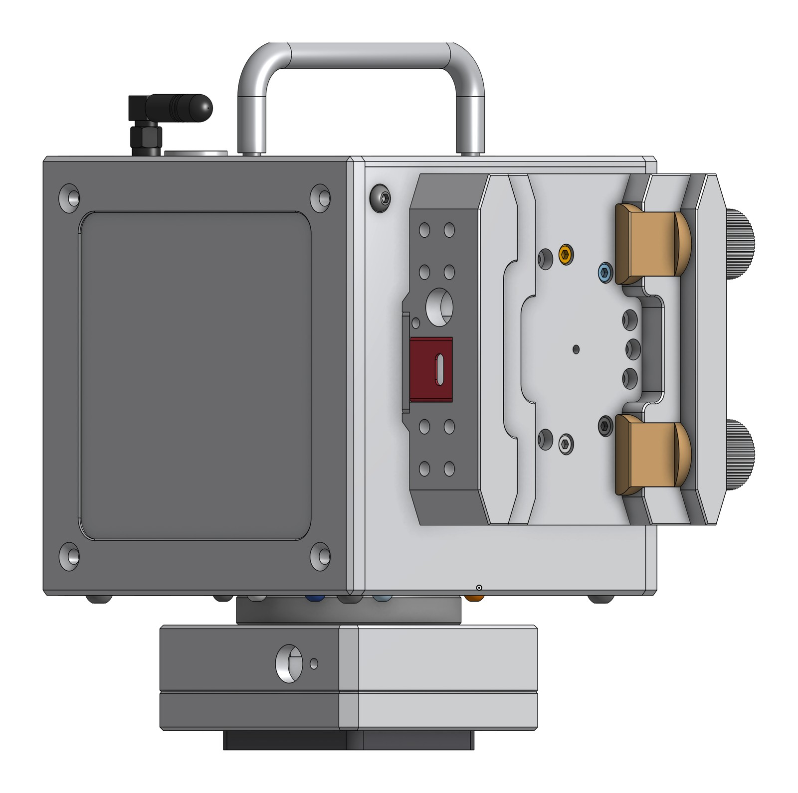
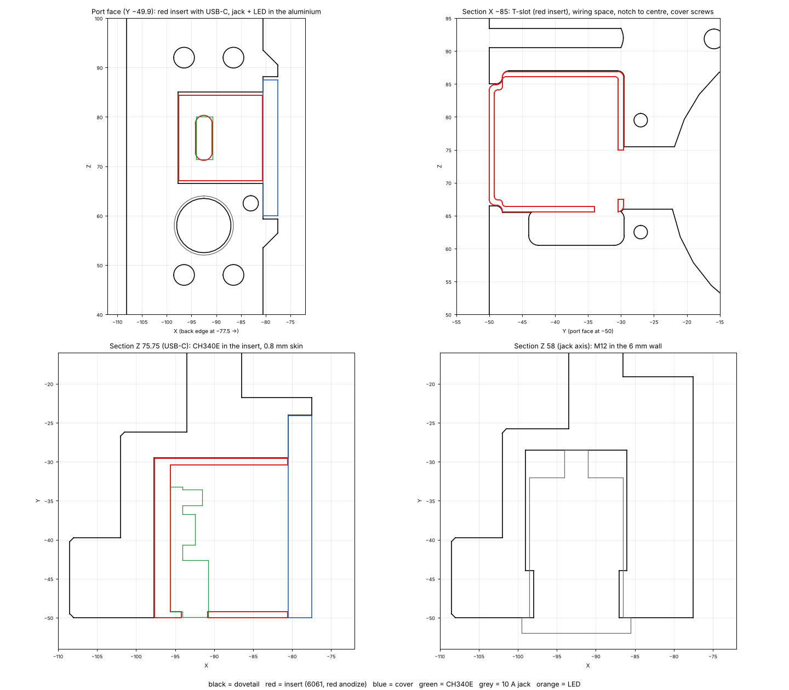

# 3. Power and wiring

[← Mechanical parts](02-mechanical-parts.md) · Next: [Electronics and firmware →](04-electronics.md)

## Power path

One 12 V cable goes into the base. Inside the box it's fused and split: one branch powers the mount, the other runs up through the DEC axis to a 12 V accessory (ACC) jack on the dovetail for a telescope-side controller (e.g. a StellaVita or a dew/focus hub).

```
12 V battery ──► base flange jack (10 A, 5.5 × 2.1) + red LED
                   │  up the RA reducer's Ø19 bore
                   ▼
             10 A main fuse
                   │
      [planned: reverse-polarity ideal diode, TVS, bulk capacitor]  (E3, E4)
                   │
                junction ── 5 A fuse ──► mount board (power switch on EN)
                   │
                   └── 7.5 A fuse ──► 18 AWG pair up the DEC bore ──► dovetail ACC jack (10 A)
```

- **Why separate fuses:** a short on the telescope side blows only the ACC fuse; the mount keeps tracking. A hard ACC short can also blow the 10 A main; that's accepted.
- **ACC sizing:** 7.5 A allows a cooled camera on the accessory controller. Without one, 5 A is enough. Measure the real draw at commissioning.
- **Typical draw:** ≈ 5–7 A with everything running, worst case ≈ 10 A. Check your battery cable and plug: many 5.5 × 2.1 plugs are only rated 5 A.
- **No reverse-polarity protection yet** on polvinc's board ([E3](design-review.md#e3)). The single-board experiment adds it; for build #1 it's an inline module after the main fuse.

## Connectors you use each night (all on side B, west)



| Where | Connector | Purpose |
|---|---|---|
| Base flange | 10 A 5.5 × 2.1 jack (tapped M12) + red LED | 12 V in |
| Dovetail | 10 A 5.5 × 2.1 jack (tapped M12) + LED | 12 V out to the telescope (ACC) |
| Dovetail | USB-C on the CH340E module, in the red insert | Serial control from the telescope side |

On side A (east): the board's own USB-C (CN2) through a window, for a laptop or firmware updates.

## Control links

OnStepX listens on all of these at once. Don't run two control programs together.

| Link | Path | OnStepX port |
|---|---|---|
| Side A USB-C | The Teensy's native USB (board connector CN2) | USB |
| Dovetail USB-C | CH340E module → UART (TX, RX, GND only) through DEC → board | Serial1 |
| Wi-Fi | LilyGO T-01C3 (ESP32-C3) on the board | Serial4 |
| GPS | ATGM336H on the board, patch antenna under the lid sticker | Serial2 |

Only the UART crosses the DEC axis, never USB data. Never wire the CH340E's USB D+/D− to the board's USB.

## The dovetail bay





polvinc's open side bay is closed and turned into a port panel (port face at Y −50 in the CAD pose):

- **10 A jack** in a 6 mm aluminium wall (tapped M12; modelled as M12 × 1, **confirm the pitch on the real jack**).
- **LED** Ø3.1 beside it, inserted from inside.
- **Red-anodized insert** above them, sliding into a T-slot from the back. It carries the CH340E module flat on its floor (2 × M2), with the module's own USB-C in a 9.1 × 3.4 mm window. The USB-C nose sits in the window, so plug side-loads go into aluminium, not the solder joints.
- **Cover:** 3 mm plate, flush, 2 × M2.5, holds the insert in.
- **Wires to DEC:** a notch joins the bay to polvinc's channel under the reducer hub and on into the bore: the ACC pair plus a 4-core cable.

Why an insert: the thin walls and every dimension that depends on the bought module are in one small, cheap part. The script [`v22_dovetail_bay.py`](../cad/tools/v22_dovetail_bay.py) regenerates the dovetail, cover and insert from measured part sizes (parameters at the top).

**USB-C module:** use TXD, RXD and GND only (leave +5V, 3V3 and DTR unconnected). The module may idle at 5 V; the Teensy is 3.3 V only. Check TXD to GND at idle on the bench: about 3.3 V can be wired direct, about 5 V needs a 1 kΩ / 2 kΩ divider, or (better) the isolator from [E1/E2](design-review.md#e1).

## Wiring through the axes

| Run | Cable | Notes |
|---|---|---|
| Base → box | 18 AWG silicone pair | Up the RA reducer's Ø19 bore |
| Box → dovetail, power | 18 AWG silicone pair, fine-stranded | Up the DEC bore |
| Box → dovetail, data | 4-core 26–28 AWG high-flex (TX, RX, GND, spare) | The spare core can power the isolator's far side |

- Leave **80–120 mm of free length** through each bore for twist, and **tie down both ends right behind the joints** so flexing never happens at a solder joint.
- Limit axis travel in OnStepX to about **±120°** to bound cable twist ([M6](design-review.md#m6)).
- The RA reducer's input bore spins ≈ 100× faster than the axis during slews. If wires can touch a spinning surface, fit a thin PTFE/nylon liner fixed to the non-rotating side.
- Crimped, keyed connectors (JST PH/XH) at the board end so the dovetail and base unplug.
- Twist each motor phase pair, the ACC pair, and TX/RX each with a ground; keep them away from the GPS lead.
