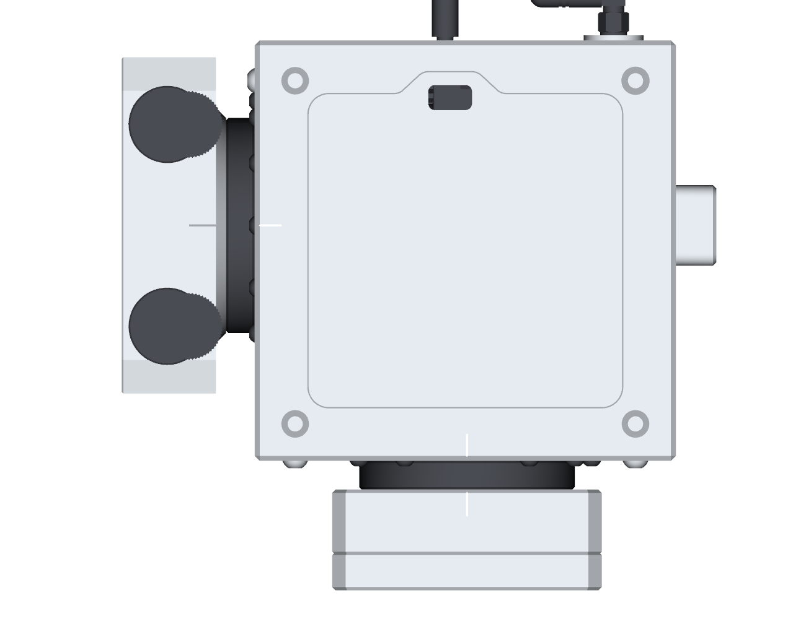

# 5. Assembly and setup

[← Electronics and firmware](04-electronics.md) · Next: [Manufacturing →](06-manufacturing.md)

> Not yet built. This is the planned sequence; it will be updated with photos and corrections after build #1.

## Build order

1. **RA reducer** into the L-plate floor, then **slide the DEC reducer** into the back wall. Clamp screws (M3 × 30) from outside, hex nuts inside, only at the 10 holes per reducer that have a matching frame hole. The reducer's counterbored holes are its own factory screws: leave them.
2. **Drive trains:** motor supports, motors (DEC motor with its leads toward −Y), pulleys, belts. NEMA17 holes may be only 4 mm deep: use a thin washer under the M3 spacers.
3. **Brake stack, from day one:** both brake supports, the 5 × 40 shaft on two 625ZZ, the 16T pulley and the 200 mm RA belt over all three pulleys; tension once. Until the brake is fitted, leave the coupling off so the 16T idles.
4. **Far wall** with its foot: 3 × M5 up through the floor, then the corner M4s.
5. **Wiring** (see [power and wiring](03-power-and-wiring.md#wiring-through-the-axes)): base leads up the RA bore, dovetail leads up the DEC bore, everything tied to fixed points and clear of the 70T pulleys and belts.
6. **Board** on its spacers under the lid; switch, Wi-Fi SMA, GPS patch in the lid pocket (seal the Ø4 lead hole with RTV after the cable is through).
7. **Side plates and lid**, M4 × 10 into the corner cubes, 1.5 N·m. The board comes up with the lid, so leave service slack in every lead.
8. **Base:** base plate onto the LA-40B (4 × M6 from above) → flange onto the RA reducer output on the bench (12 × M3 from below) → mount onto the plate (4 × M5 up from below).
9. Small silica gel pack inside.

## First power-up

- Bench power first, motors unplugged. Check 5 V and 3.3 V.
- **Never plug or unplug a stepper with its driver powered.**
- Brake board: measure ≈ 23 V at its output **before** connecting the brake coil.
- USB-serial module: measure TXD to GND at idle (≈ 3.3 V wire direct; ≈ 5 V needs level shifting).
- With the brake fitted: confirm it stays engaged from power-on until OnStepX enables RA.

## Home position

Counterweight down, scope parallel to the RA axis, **dovetail knobs east**. That is DEC turned 180° from the CAD pose.

Side A carries both home marks (90° V-grooves, 0.3 mm deep, 8 mm long, filled with white paint pen):
- **DEC:** at Z 70 near the back edge of side A, meeting the single mark on the dovetail's knob face.
- **RA:** at the bottom edge of side A, meeting a mark on the base flange's side A face.

RA also lines up 180° away (counterweight up). Home is **marks aligned and knobs east and counterweight down.** Route the DEC wires untwisted in this pose and set it as home in OnStepX.

## Balancing

There is no clutch; the reducer and motor detent resist turning unpowered, so balance by **bracketing**:

1. Slide the weight in until the scope side drifts down; mark.
2. Slide it out until the counterweight side drifts down; mark.
3. Set it at the midpoint. (Belt off makes this more precise.)
4. Then offset RA ≈ **0.5 N·m east-heavy** (about 1 cm of weight travel; the direction flips with pier side), so the gears stay loaded one way through the 40–50″ backlash.

For DEC, use PHD2's one-direction DEC guiding or backlash compensation with a slight DEC imbalance.

**Safety:**
- Load or unload the scope only with the motors powered and holding, or with the counterweight off. Without the brake, an unpowered mount can swing.
- Keep hands off the clamp knobs during slews: they pass 7 mm from the body ([M10](design-review.md#m10)).

## Commissioning

1. Slew slowly through home and the meridian; check counterweight, tripod-leg and cable clearances.
2. Measure the real current draw (mount and ACC) and confirm the fuse sizes.
3. PHD2 Guiding Assistant with guiding off, ~30 min near the celestial equator: periodic error and DEC backlash.
4. Check for missed steps at the lower motor currents, at the worst imbalance and on a cold night.
5. Watch for condensation inside after the first few nights.
